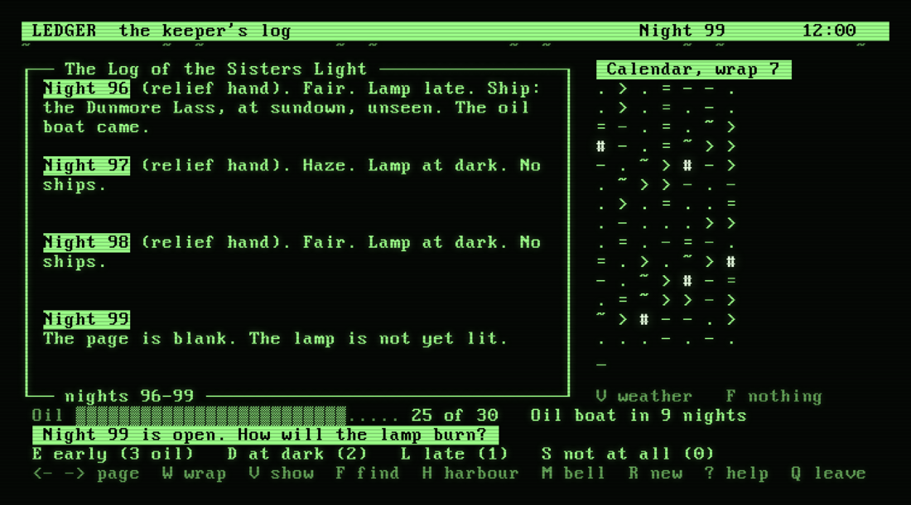

# Ledger (LEDGER)

The lighthouse keeper's logbook, written in **Z80 assembly** for **CP/M 2.2**. 4 MHz, 80x24,
VT100 (line drawing, scroll region, dim, bold, blink, reverse) / VT52 / ADM-3A. One `.COM`, no hurry,
nothing to lose.



You keep a coastal light for a village and never see the sea, only the book. Each night (three hours
of the real clock) you choose how the lamp burns, early, at dark, late or not at all, and the words you
write. What passed in the dark is only in the log, and the patterns in the log predict the storms and
the ships: a ship that came on the 3rd, the 10th and the 17th will come again. There is no combat; the
tension is whether to light the lamp early or save the oil. Away, a relief hand keeps the lamp and
writes plain entries. The diary, `LEDGER.LOG`, is plain text you can `TYPE`.

- A page of the log on the left, a calendar on the right that folds the nights into rows: change the
  width until a pattern lines up.
- Five ships on timetables, strangers, fronts that run swell, wind and storm, and a harbour book of
  who answered whose light.
- A night is three hours of the machine's clock, and the nights you miss are kept for you in a few
  seconds (a very long absence is capped).
- A safe save (written beside, renamed when whole), a new log (`R`), and a diary in plain text.

## Playing

You need a CP/M 2.2 machine (or an emulator) with a VT100, VT52 or ADM-3A console. Take `LEDGER.COM`
from the [releases](https://github.com/cstroie/ledger/releases) and copy it onto a disk, then run:

```
A>LEDGER            asks for your terminal the first time
A>LEDGER /100       VT100        /52   VT52        /ADM   ADM-3A
A>LEDGER /S1234     (a new log only) the sea of a given number
```

The state is in `LEDGER.SAV` and the diary in `LEDGER.LOG`, next to the program. A real-time clock on
port 20 gives the date and time; without one every start is the next night. It sits on the shelf of
[DigitalRerun](https://github.com/cstroie/digital-rerun), a CP/M computer in the browser: *Games*,
*Ledger*, *Insert*, then type `PLAY`.

### Keys

The bottom line of the screen always shows the keys that work just then.

| Key | |
|---|---|
| `E` `D` `L` `S` | light the lamp early, at dark, late, or not at all (only while the night is open) |
| `1` `2` `3` | choose the words (Enter takes the first) |
| left, right (or `,` `.`) | turn the page |
| `W` | change the calendar's width, 5 to 12 |
| `V` | what the calendar shows: weather, ships, lamp |
| `F` | find one thing (storms, swells, wind, fog, each ship) and light it on the calendar |
| `H` | the harbour book: the ships, how often their light was answered, their letters |
| `M` `R` `?` `Q` | the bell on and off; a new log (asks first); the introduction; leave |

### How a night goes

The lamp burns oil: early costs 3, at dark 2, late 1, not at all 0 (fog and storm burn one more), and
a boat brings 24 on every twelfth night. Then the night passes along the horizon, and you write the
entry with three choices among three ways of saying what happened: the weather, the lamp, the ships. A
ship is seen if your lamp was lit no later than she passed; neither a missed nor an answered light
costs anything. A ship whose light is answered often enough writes to you. Leave the screen open and a
bell rings when a night begins; close it, come back in a week, and the relief hand has kept the log.

The full player's text is in [`docs/PLAYING.txt`](docs/PLAYING.txt). I will not spoil the rest.

## Building

You need [pasmo](https://pasmo.speccy.org/) (`apt install pasmo`) and Node.js.

```
sh build.sh                  words.inc from words.txt (mkwords.js), then LEDGER.COM (pasmo)
PASMO=/path/to/pasmo sh build.sh
DEST=/some/disk/dir sh build.sh      also copy the program there
```

The phrases of the log are in `words.txt`; `mkwords.js` checks and packs them into `words.inc`.
`LEDGER.COM` is not kept in git: the releases carry it.
The version is in [VERSION](VERSION), the history in [CHANGELOG.md](CHANGELOG.md).

## Source

| File | Role |
|------|------|
| `ledger.asm` | start, key dispatch, `sync` (catching up), `poll` (the clock, live), memory map |
| `world.asm` | the sea as a pure function, the lamp and oil, the entry, the ring of 128 nights |
| `fmt.asm`, `text.asm` | an entry as a sentence; the words |
| `ui.asm` | every screen: the book, the calendar, the panel, the horizon, composing, harbour, welcome |
| `clock.asm`, `term.asm`, `save.asm` | the clock and 32-bit arithmetic; the terminal driver; `LEDGER.SAV` and `LEDGER.LOG` |
| `words.txt`, `mkwords.js` | the phrases of the log, and their checker and packer |
| `tools/ledger.js` | the world again in JavaScript: the tests' oracle, and a way to look at a sea |

[`DESIGN.md`](DESIGN.md) is the design document: the clock, the sea, the log and the formats.

## Testing

```
ROOT=/path/to/digital-rerun node --test test/*.test.js     (build first)
```

`tools/ledger.js` is the world written a second time in JavaScript. The tests run the real `.COM` in the
emulator of a [DigitalRerun](https://github.com/cstroie/digital-rerun) checkout (default: a
`digital-rerun` folder next to this one) and compare its `LEDGER.LOG` with what the model says the sea
did, so the two must agree to the bit. Without the checkout only the text and model tests run.
`node tools/ledger.js 1234 60` prints sixty nights of the sea numbered 1234.

## Licence

MIT, see [LICENSE](LICENSE). Copyright (c) 2026 Costin Stroie. Ledger is a separate project from
DigitalRerun: DigitalRerun only ships the built `LEDGER.COM`, under this same licence, and its own
licence terms do not apply to it.
